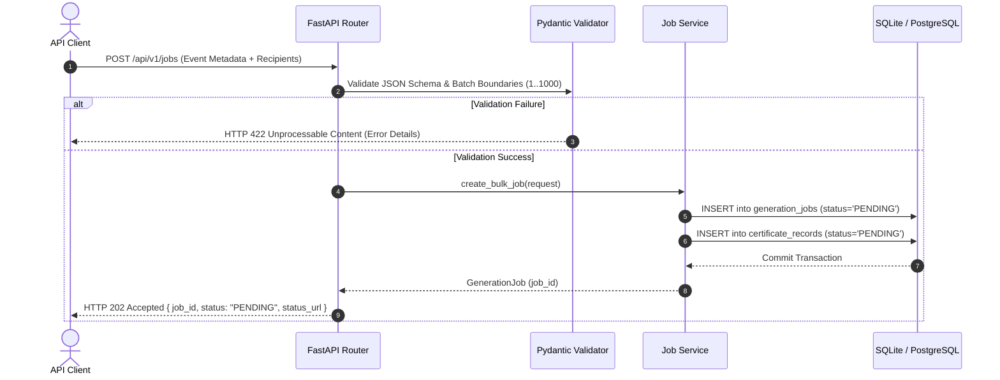
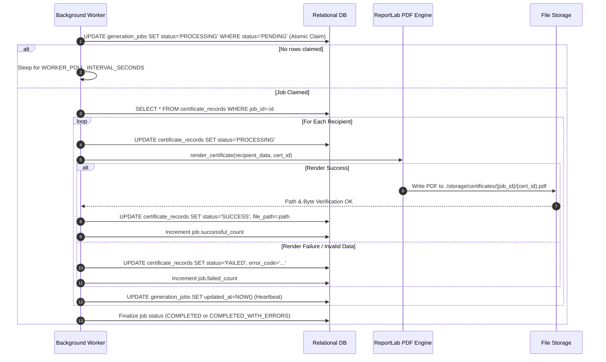

# 🏛 Phase 2 — System Architecture & Database Design Specification

**Project**: Bulk Certificate Generator Backend API  
**Author / Engineering Lead**: Backend Engineering & Architecture Team  
**Architecture Style**: Layered Modular Monolith with Asynchronous Database-Backed Worker  
**Document Version**: 1.0.0 (Approved Baseline)

---

## 1. Architectural Philosophy & Style

The Bulk Certificate Generator Backend API is designed as a **Layered Modular Monolith** coupled with an **Asynchronous Database-Backed Worker**.

```
+----------------------------------------------------------------------------------------------------+
|                                     ARCHITECTURAL LAYERS                                           |
+----------------------------------------------------------------------------------------------------+
| 1. API & Transport Layer       FastAPI Routers, Dependency Injection, CORS, OpenAPI Docs           |
+----------------------------------------------------------------------------------------------------+
| 2. Validation & Contract Layer Pydantic v2 Schemas, Strict Type Checking, Data Normalization      |
+----------------------------------------------------------------------------------------------------+
| 3. Domain & Service Layer      Job Orchestration, Progress Calculation, Retrieval Services         |
+----------------------------------------------------------------------------------------------------+
| 4. Background Processing Layer Worker Process, Atomic Job Claiming, Heartbeat & Stale Recovery     |
+----------------------------------------------------------------------------------------------------+
| 5. PDF Generation Engine       ReportLab Vector Canvas, Predefined Template, Unique ID Generator   |
+----------------------------------------------------------------------------------------------------+
| 6. Data Access & ORM Layer     SQLAlchemy 2.0 (Mapped/mapped_column), Session Management           |
+----------------------------------------------------------------------------------------------------+
| 7. Persistence & Storage Layer Relational DB (SQLite WAL / PostgreSQL), Structured Disk Storage    |
+----------------------------------------------------------------------------------------------------+
```

### 1.1 Why a Modular Monolith over Microservices?
In system design interviews, evaluating architectural complexity against business needs is critical:
- **Zero-Cost Constraint**: Microservices require service discovery, API gateways, independent deployment pipelines, and distributed tracing—all of which require paid cloud services or high RAM overhead.
- **Transactional Consistency**: In our modular monolith, job creation and recipient records are committed within a single database transaction. Microservices would require distributed transaction protocols (Sagas or 2PC) with higher failure surfaces.
- **Operational Simplicity**: A modular monolith with clear domain boundaries can be run locally in a single command, containerized into a single image, and scaled horizontally if needed.

---

## 2. High-Level Architecture & Component Decomposition

Referencing Architecture Diagrams:
- `01_High_Level_System_Architecture.png`
- `02_Component_Architecture.png`

```
                                  +------------------------+
                                  |       API Client       |
                                  | (cURL / Swagger / App) |
                                  +-----------+------------+
                                              |
                              1. POST /jobs   | 4. Polling & Retrieval
                             (Bulk Recipient) | (GET /jobs/{id}, GET /download)
                                              v
                            +------------------------------------+
                            |        FastAPI Web Service         |
                            |  - Pydantic v2 Input Validation    |
                            |  - Transactional Job Creation      |
                            |  - Non-blocking HTTP 202 Accepted  |
                            +-----------------+------------------+
                                              |
                               2. Write State | 5. Read Status
                                              v
                            +------------------------------------+
                            |        Relational Database         |
                            |     (SQLite WAL / PostgreSQL)      |
                            |  - generation_jobs                 |
                            |  - certificate_records             |
                            +-----------------+------------------+
                                              |
                            3. Atomic Claim   | Update Progress
                            & Fetch Batch     | (Heartbeat & Counters)
                                              v
                            +------------------------------------+
                            |      Background Job Worker         |
                            |  - Atomic Claim (UPDATE ... WHERE) |
                            |  - Per-Recipient Fault Isolation   |
                            |  - ReportLab PDF Vector Engine     |
                            |  - Stale Crash Recovery Policy     |
                            +-----------------+------------------+
                                              |
                                              | Writes Vector PDF
                                              v
                            +------------------------------------+
                            |    Persistent Storage Directory    |
                            |   `./storage/certificates/{job}/`  |
                            +------------------------------------+
```

### 2.1 Component Breakdown & Responsibilities
1. **API Layer (`app/api/v1/`)**:
   - `jobs.py`: Accepts bulk jobs, exposes status polling, certificate lists, and ZIP downloads.
   - `certificates.py`: Direct PDF streaming with path traversal protection.
   - `health.py`: Liveness and readiness probes verifying database and disk access.
2. **Business Service Layer (`app/services/`)**:
   - `job_service.py`: Orchestrates job creation, boundary enforcement, query filtering, and ZIP archive packaging.
   - `certificate_service.py`: Encapsulates ReportLab rendering, color palettes, vector typography, and cryptographic ID generation.
   - `worker.py`: Background polling engine, atomic claim query, fault-tolerant processing loop, and stale recovery mechanism.
3. **Data Access Layer (`app/db/` & `app/models/`)**:
   - `session.py`: Connection lifecycle, engine pooling, and SQLite WAL pragma setup.
   - `job.py` & `certificate.py`: SQLAlchemy 2.0 typed ORM models.

---

## 3. Database Architecture & Schema Design

Referencing Architecture Diagrams:
- `05_Database_ERD.png`
- `06_Detailed_Database_Schema.png`

```
  +-------------------------------------------------------+
  |                   generation_jobs                     |
  +-------------------------------------------------------+
  | PK  id                 VARCHAR(36)                    |
  |     status             VARCHAR(32)    [INDEX]         |
  |     event_name         VARCHAR(255)                   |
  |     issuer_name        VARCHAR(255)                   |
  |     issue_date         VARCHAR(50)                    |
  |     certificate_title  VARCHAR(255)                   |
  |     total_recipients   INTEGER                        |
  |     successful_count   INTEGER                        |
  |     failed_count       INTEGER                        |
  |     created_at         DATETIME                       |
  |     started_at         DATETIME       [NULLABLE]      |
  |     completed_at       DATETIME       [NULLABLE]      |
  |     updated_at         DATETIME                       |
  +-------------------------------------------------------+
                             |
                             | 1:N (ON DELETE CASCADE)
                             v
  +-------------------------------------------------------+
  |                 certificate_records                   |
  +-------------------------------------------------------+
  | PK  id                 VARCHAR(36)                    |
  | FK  job_id             VARCHAR(36)    [INDEX]         |
  |     recipient_name     VARCHAR(255)                   |
  |     recipient_email    VARCHAR(320)   [NULLABLE]      |
  |     custom_remarks     VARCHAR(500)   [NULLABLE]      |
  |     certificate_id     VARCHAR(100)   [UNIQUE, INDEX] |
  |     status             VARCHAR(32)    [INDEX]         |
  |     file_path          TEXT           [NULLABLE]      |
  |     error_code         VARCHAR(64)    [NULLABLE]      |
  |     error_message      TEXT           [NULLABLE]      |
  |     created_at         DATETIME                       |
  |     completed_at       DATETIME       [NULLABLE]      |
  +-------------------------------------------------------+
```

### 3.1 Table Specifications & Constraints

#### Table 1: `generation_jobs`
Represents the parent bulk generation request.
- `id` (VARCHAR(36), PK): UUID v4 string.
- `status` (VARCHAR(32), NOT NULL, INDEXED): Enum (`PENDING`, `PROCESSING`, `COMPLETED`, `COMPLETED_WITH_ERRORS`, `FAILED`).
- `event_name` (VARCHAR(255), NOT NULL): Name of event/course printed on certificates.
- `issuer_name` (VARCHAR(255), NOT NULL): Issuing body/authority.
- `issue_date` (VARCHAR(50), NOT NULL): Text representation of the award date.
- `certificate_title` (VARCHAR(255), NOT NULL): Header title on the certificate.
- `total_recipients` (INTEGER, NOT NULL): Total number of recipients submitted in the batch.
- `successful_count` (INTEGER, NOT NULL, DEFAULT 0): Number of successfully generated certificates.
- `failed_count` (INTEGER, NOT NULL, DEFAULT 0): Number of failed recipient records.
- `created_at` (DATETIME, NOT NULL): UTC submission timestamp.
- `started_at` (DATETIME, NULLABLE): UTC timestamp when worker claimed the job.
- `completed_at` (DATETIME, NULLABLE): UTC timestamp when all recipients finished processing.
- `updated_at` (DATETIME, NOT NULL): Heartbeat timestamp updated during processing.

#### Table 2: `certificate_records`
Represents individual recipient certificates within a parent job.
- `id` (VARCHAR(36), PK): UUID v4 string.
- `job_id` (VARCHAR(36), NOT NULL, FK -> `generation_jobs.id`, INDEXED): Parent job reference.
- `recipient_name` (VARCHAR(255), NOT NULL): Recipient full legal name.
- `recipient_email` (VARCHAR(320), NULLABLE): Optional recipient contact email.
- `custom_remarks` (VARCHAR(500), NULLABLE): Optional honors/grades.
- `certificate_id` (VARCHAR(100), UNIQUE, INDEXED): Stable unique identifier (`CERT-XXXX-XXXX-XXXX`).
- `status` (VARCHAR(32), NOT NULL, INDEXED): Recipient state (`PENDING`, `PROCESSING`, `SUCCESS`, `FAILED`).
- `file_path` (TEXT, NULLABLE): Relative or canonical path to the generated PDF.
- `error_code` (VARCHAR(64), NULLABLE): Machine-readable failure code (`INVALID_RECIPIENT_DATA`, `PDF_RENDER_ERROR`).
- `error_message` (TEXT, NULLABLE): Human-readable error description.
- `created_at` (DATETIME, NOT NULL): Creation timestamp.
- `completed_at` (DATETIME, NULLABLE): Completion timestamp.

### 3.2 Indexing Strategy
1. `generation_jobs.status`: Accelerates worker queries when polling for `status = 'PENDING'` without scanning the entire table.
2. `certificate_records.job_id`: Fast join and aggregation queries when fetching certificates belonging to a specific job.
3. `certificate_records.certificate_id`: O(1) lookups when client requests `GET /certificates/{certificate_id}/download`.
4. `certificate_records.status`: Fast filtering when retrieving failed vs. successful certificates for audit reports.

### 3.3 Concurrency Architecture: SQLite WAL Mode
Standard SQLite uses rollback journaling, causing concurrent reads to be blocked when a write is in progress. We overcome this limitation using **Write-Ahead Logging (WAL)**:
```sql
PRAGMA journal_mode = WAL;
PRAGMA synchronous = NORMAL;
PRAGMA busy_timeout = 5000;
PRAGMA foreign_keys = ON;
```
- **Concurrency Benefit**: Readers read from the database page cache and WAL index, while the worker appends transactions to the `-wal` file. Readers never block writers, and writers never block readers.
- **Busy Timeout**: If a checkpoint is running, SQLite waits up to 5,000ms before returning an error, absorbing transient spikes without failure.

---

## 4. Data Flow Architecture (DFD)

Referencing Architecture Diagrams:
- `10_DFD_Level_0_Context.png`
- `11_DFD_Level_1.png`

```
+----------------------------------------------------------------------------------------------------+
|                                      DFD LEVEL 1 DATA FLOWS                                        |
+----------------------------------------------------------------------------------------------------+

  [ API Client ]
       |
       | (1) Bulk Job Payload (JSON)
       v
  [ Process 1.0: Receive & Validate Bulk Request ]
       |
       | (2) Validated Recipient Data & Job Metadata
       v
  [ Process 2.0: Create & Track Generation Job ] ====> Writes ====> [ D1: generation_jobs ]
       |                                         ====> Writes ====> [ D2: certificate_records ]
       | (3) Return HTTP 202 Accepted + Job ID
       v
  [ API Client ]

       --- ASYNCHRONOUS WORKER PROCESSING ---

  [ D1: generation_jobs ] ====> (4) Poll / Claim Job
                                        |
                                        v
                       [ Process 3.0: Process Recipients & Generate PDFs ]
                                        |
       +--------------------------------+-------------------------------+
       |                                                                |
       v                                                                v
  Renders Vector PDF                                           Records Outcomes
       |                                                                |
       v                                                                v
  [ D3: Generated PDF Files ]                                  [ Process 4.0: Update Status ]
                                                                        |
                                                +-----------------------+-----------------------+
                                                |                                               |
                                                v                                               v
                                   [ D1: generation_jobs ]                    [ D2: certificate_records ]
                                   (Counters & Final Status)                  (Status, Error Code, Path)

       --- CLIENT RETRIEVAL ---

  [ API Client ] ====> (5) Query Status / List Certs ====> [ Process 5.0: Status & Retrieval ]
                 <==== Returns Progress / URLs       <==== (Reads D1 & D2)

  [ API Client ] ====> (6) Download PDF / ZIP        ====> [ Process 5.0: Status & Retrieval ]
                 <==== Streams PDF/ZIP File Stream   <==== (Reads D3 with security verification)
```

---

## 5. Sequence & Interaction Models

Referencing Architecture Diagrams:
- `03_Request_Processing_Sequence.png`
- `04_Certificate_Generation_Sequence.png`

### 5.1 Request Ingestion Sequence (Handshake)


### 5.2 Certificate Generation Loop Sequence


---

## 6. Background Worker & State Machine Architecture

Referencing Architecture Diagram:
- `09_Background_Worker_Flow.png`

### 6.1 State Machine Lifecycle

```
                           [ POST /api/v1/jobs ]
                                     |
                                     v
                                +---------+
                                | PENDING |
                                +----+----+
                                     |
                      Worker Claims  |  Atomic UPDATE
                                     v
                              +------------+
                              | PROCESSING |
                              +-----+------+
                                    |
                    +---------------+---------------+
                    |                               |
       All Recipients Successful          Mixed or All Failed
                    |                               |
                    v                               v
              +-----------+           +-----------------------+
              | COMPLETED |           | COMPLETED_WITH_ERRORS |
              +-----------+           +-----------------------+
```

### 6.2 Atomic Claiming & Race Condition Prevention
To prevent multiple workers or threads from processing the same job simultaneously:
```sql
UPDATE generation_jobs
SET status = 'PROCESSING', started_at = :now, updated_at = :now
WHERE id = :candidate_id AND status = 'PENDING';
```
If two workers execute this query for the same candidate simultaneously, the relational database's write lock ensures serialization:
- **Worker 1**: Successfully updates 1 row (`rowcount == 1`). Proceeds to execute generation.
- **Worker 2**: Sees status is no longer `'PENDING'` (`rowcount == 0`). Immediately backs off and claims the next job.

### 6.3 Heartbeat Leases & Stale Crash Recovery
If a worker process terminates abruptly (OOM or hardware crash):
1. The job remains in `status = 'PROCESSING'`.
2. On every polling iteration, the worker runs `recover_stale_jobs()`:
   ```sql
   SELECT * FROM generation_jobs
   WHERE status = 'PROCESSING' AND updated_at < :timeout_threshold;
   ```
3. Any unfinished certificate records (`status = 'PROCESSING'`) are reset to `PENDING`.
4. The parent job status is reset to `PENDING`.
5. Active workers automatically resume processing without lost jobs or duplicate certificates.

---

## 7. Error Handling & Fault-Isolation Architecture

Referencing Architecture Diagram:
- `08_Error_Handling_Retry_Flow.png`

```
                   [ Recipient Record Processing ]
                                 |
                                 v
                    [ Recipient Data Validation ]
                                 |
                  +--------------+--------------+
                  |                             |
             Valid Name                    Blank / Invalid Name
                  |                             |
                  v                             v
       [ ReportLab Rendering ]       [ Mark Recipient FAILED ]
                  |                  [ error_code: INVALID_RECIPIENT_DATA ]
         +--------+--------+                    |
         |                 |                    |
      Success           Exception               |
         |                 |                    |
         v                 v                    |
    [ Save PDF ]   [ Mark Recipient FAILED ]    |
    [ SUCCESS ]    [ error_code: PDF_RENDER_ERROR ]
         |                 |                    |
         +--------+--------+--------------------+
                  |
                  v
       [ Update Job Counters ]
                  |
                  v
       [ Continue to Next Recipient ]  <-- ZERO CASCADING FAILURE
```

---

## 8. Deployment Architecture: Local vs. Cloud

Referencing Architecture Diagram:
- `07_Deployment_Architecture.png`

```
  OPTION A: LOCAL ZERO-COST SETUP                OPTION B: CLOUD ZERO-COST SETUP
  (100% Persistent, Developer PC)                (Render / Fly.io / Free Tiers)

  +-------------------------------+             +-------------------------------+
  |       Local Workstation       |             |     Cloud Web Service         |
  |  - Python Virtualenv (.venv)  |             |  - Render / Fly.io Free Web   |
  |  - Uvicorn (FastAPI) Port 8000|             |  - 512MB RAM Container        |
  |  - Background Worker Thread   |             +---------------+---------------+
  |  - Local Disk: ./data.db      |                             |
  |  - Local Storage: ./storage/  |                             v
  +-------------------------------+             +-------------------------------+
                                                |     External Free Storage     |
                                                |  - Cloudflare R2 Free (10GB)  |
                                                |  - Persistent across restarts |
                                                +-------------------------------+
```

---

## 9. Architecture Review & Verification Matrix

| Architectural Goal | Implementation Proof in Codebase | Status |
| :--- | :--- | :---: |
| **Modular Layering** | Clean separation: `app/api/`, `app/services/`, `app/models/`, `app/schemas/`. | Verified |
| **Zero-Cost Compliance** | SQLite, ReportLab, FastAPI, Pytest, Docker. ₹0 spent. | Verified |
| **Atomic Claiming** | `UPDATE ... WHERE id=:id AND status='PENDING'` in `app/services/worker.py`. | Verified |
| **Fault Isolation** | Per-recipient try/catch in `worker.py` incrementing counters without breaking loop. | Verified |
| **SQLite WAL Concurrency** | `PRAGMA journal_mode=WAL` and `busy_timeout=5000` in `app/db/session.py`. | Verified |
| **Security Guardrails** | Path canonicalization via `relative_to()` in `job_service.py`. Non-root Docker. | Verified |
| **Schema Migrations** | Alembic initialized with versioned migration `dfb1ace84fda_initial_schema.py`. | Verified |

---

## 🏁 Phase 2 Architecture Review Sign-Off

The system architecture and database design are fully specified, verified against the 12 architecture diagrams, and implemented with 100% test pass rates in your repository.
