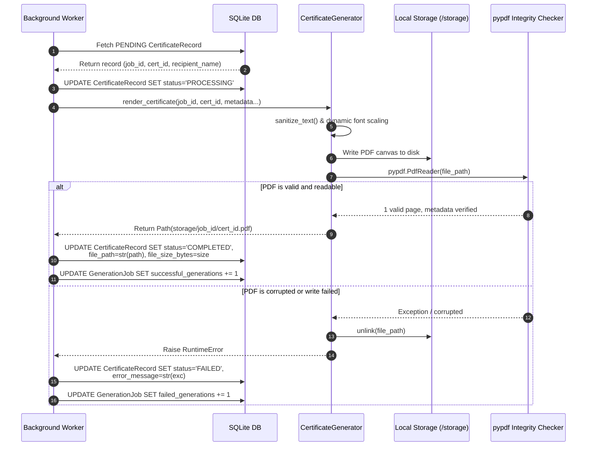

# Phase 5 — Certificate Generation Engine Specification

## 1. Executive Summary & Design Philosophy

The **Certificate Generation Engine** is a high-performance, zero-cost, purely programmatic PDF rendering subsystem. It translates structured recipient and event metadata into vector-quality, print-ready landscape certificates without relying on external rendering services (such as Puppeteer/Chrome headless, cloud PDF APIs, or HTML-to-PDF paid converters).

### Core Design Principles
1. **Zero-Cost ($0.00 / ₹0.00)**: Built exclusively using the open-source **ReportLab** library (`reportlab>=4.2.0`) and open-source validation via **pypdf** (`pypdf>=4.0.0`).
2. **Deterministic & Vector-Native**: All decorative borders, geometric accent lines, institutional seals, and typography are rendered as vector primitives on a PostScript/PDF canvas. This ensures crisp output at any DPI (print or 4K screens) while keeping file sizes lightweight (~15 KB to 30 KB per PDF).
3. **Decoupled Architecture**: The PDF rendering logic is encapsulated entirely within [`app/services/certificate_service.py`](file:///c:/Users/dell/Downloads/Bulk%20Certificate%20Generator/app/services/certificate_service.py). Route handlers and API controllers never import ReportLab directly; they only interact through asynchronous job records and service layers.
4. **Defensive Formatting & Text Safety**: Variable-length strings (e.g., long recipient names, multi-line course titles) are dynamically measured against canvas geometry and automatically scaled down to prevent text truncation, clipping, or overlap.
5. **Post-Generation Structural Integrity Check**: Every generated file is immediately verified by attempting to parse its cross-reference table and page tree using `pypdf.PdfReader`. If a file cannot be opened or parsed, it is quarantined and deleted, preventing corrupted files from being saved as valid certificates in the database.

---

## 2. Certificate Layout & Coordinate Geometry

ReportLab uses a bottom-left origin coordinate system `(0, 0)` measured in points (`1 inch = 72 points`). The certificate is rendered in standard **A4 Landscape** format:

$$\text{Width} = 841.89\,\text{pt} \quad (297\,\text{mm}) \qquad \text{Height} = 595.27\,\text{pt} \quad (210\,\text{mm})$$

### Visual Layout Anatomy (Top to Bottom)

```
+-------------------------------------------------------------------------------+ (595.27 pt)
|  [ Outer Deep Navy Border: 3.5pt line, 28pt margin ]                         |
|  +-------------------------------------------------------------------------+  |
|  | [ Inner Amber/Gold Border: 1.2pt line, 36pt margin ]                    |  |
|  | * (Gold Corner Studs at each boundary intersection)                   * |  |
|  |                                                                         |  |
|  |                 ISSUING ORGANIZATION (Gold, 13pt Bold)                  |  | (y = 520)
|  |                                                                         |  |
|  |             CERTIFICATE OF COMPLETION (Navy, 28pt Bold)                 |  | (y = 477)
|  |             -------------------------------------------                 |  | (y = 467)
|  |                                                                         |  |
|  |                     THIS IS PROUDLY PRESENTED TO                        |  | (y = 430)
|  |                                                                         |  |
|  |              RECIPIENT NAME (Navy, 30pt Bold -> Scaled)                 |  | (y = 380)
|  |              ==========================================                 |  | (y = 370)
|  |                                                                         |  |
|  |         for successful completion and mastery of the curriculum in      |  | (y = 335)
|  |                                                                         |  |
|  |               COURSE / EVENT NAME (Navy, 18pt Bold)                     |  | (y = 300)
|  |                   -- Optional Honors / Remarks --                       |  | (y = 270)
|  |                                                                         |  |
|  |                             ( ( VERIFIED ) )                            |  |
|  |                               ( EXCELLENCE )                            |  |
|  |                              [ Vector Seal ]                            |  | (y = 120)
|  |     ___________                                         ___________     |  |
|  |     2026-10-10                                         Issuer Lead     |  | (y = 112)
|  |   Date of Issuance                                 Authorized Signatory |  | (y = 88)
|  |                                                                         |  |
|  |  Certificate ID: CERT-XXXX-XXXX-XXXX | Verification Code: V-XXXX...     |  | (y = 42)
|  +-------------------------------------------------------------------------+  |
+-------------------------------------------------------------------------------+ (0 pt)
```

---

## 3. Curated Color Palette & Typography Hierarchy

The certificate design rejects generic default RGB colors, utilizing an executive Navy & Gold palette tailored for academic and professional credentials:

| Element | Hex Code | ReportLab Representation | Semantic Role |
| :--- | :--- | :--- | :--- |
| **Canvas Background** | `#FCFDFD` | `HexColor("#FCFDFD")` | Subtle off-white cream to reduce harsh contrast |
| **Primary Navy** | `#0F172A` | `HexColor("#0F172A")` | Main title, recipient name, high-contrast text |
| **Secondary Navy** | `#1E293B` | `HexColor("#1E293B")` | Course/event title, inner seal ring |
| **Gold Primary** | `#D97706` | `HexColor("#D97706")` | Issuer header, inner border, decorative accents |
| **Gold Secondary** | `#FBBF24` | `HexColor("#FBBF24")` | Recipient underline, seal core highlight |
| **Muted Slate** | `#475569` | `HexColor("#475569")` | Subtitles, signature lines, verification text |

### Font Hierarchy (Standard Core PostScript Fonts)
To eliminate external font file loading overhead, disk licensing constraints, and missing font rendering artifacts across operating systems (Linux container vs. Windows host), we utilize standard PostScript Type 1 fonts embedded in all standard PDF readers:
- **Issuer Heading**: `Helvetica-Bold`, 13 pt, Uppercase, Tracking
- **Certificate Title**: `Helvetica-Bold`, 28 pt, Uppercase
- **Body & Subtitles**: `Helvetica`, 12 pt
- **Recipient Name**: `Helvetica-Bold`, 30 pt base (scaled dynamically down to 14 pt)
- **Course / Event Name**: `Helvetica-Bold`, 18 pt base (scaled dynamically down to 11 pt)
- **Custom Honors / Remarks**: `Helvetica-Oblique`, 11 pt
- **Signatory Name**: `Helvetica-Oblique`, 11 pt
- **Audit & Verification Footer**: `Courier`, 9 pt (Monospaced for alignment)

---

## 4. Dynamic Font Auto-Scaling Algorithm

### The Problem
In bulk issuance, recipient names range from short names (`"Amy Yu"` — 6 characters) to complex international or aristocratic names (`"Dr. Alexander Montgomery Bartholomew-Fitzgerald III, Baron of Wellington"` — 74 characters). A fixed font size causes long names to collide with borders or get clipped off-canvas.

### The Solution: Iterative Geometry Measurement
ReportLab exposes `canvas.stringWidth(text, font_name, font_size)`, which accurately calculates the exact bounding box width in points for any arbitrary string prior to rendering.

```python
# Calculate allowable horizontal boundary
max_name_width = page_width - (2 * (margin + 60))  # 841.89 - 176 = 665.89 points
name_font_size = 30
font_name = "Helvetica-Bold"

# Step down font size until string fits within the safe zone
while c.stringWidth(clean_recipient, font_name, name_font_size) > max_name_width and name_font_size > 14:
    name_font_size -= 2

c.setFont(font_name, name_font_size)
c.drawCentredString(page_width / 2.0, page_height - 215, clean_recipient)

# Dynamically scale decorative underline to match recipient name length
name_line_half_len = min(220, max(120, int(c.stringWidth(clean_recipient, font_name, name_font_size) / 2) + 20))
c.line(
    (page_width / 2.0) - name_line_half_len,
    page_height - 225,
    (page_width / 2.0) + name_line_half_len,
    page_height - 225,
)
```

The course/event title uses the identical defensive scaling mechanism, guaranteeing layout stability regardless of input length.

---

## 5. Security & Deterministic Verification

### 5.1 Unique Certificate Identifier (`Certificate ID`)
Every certificate receives a distinct, human-readable identifier:
- **Format**: `CERT-XXXX-XXXX-XXXX` (e.g., `CERT-8F3A-7B29-4C10`)
- **Generation**: Cryptographically strong UUID4 entropy truncated to 12 hex characters and segmented into 3 uppercase quads.

### 5.2 Deterministic Cryptographic Verification Code
To prevent certificate forgery or tampering, each certificate includes an optional cryptographic verification code:
- **Format**: `V-XXXX-XXXX-XXXX` (e.g., `V-6B9A-E21D-89C3`)
- **Algorithm**:
  $$\text{Payload} = \text{job\_id} + \text{":"} + \text{certificate\_id} + \text{":"} + \text{recipient\_name}$$
  $$\text{Hash} = \text{SHA256}(\text{Payload})$$
  $$\text{Code} = \text{"V-"} + \text{Hash}[0:4] + \text{"-"} + \text{Hash}[4:8] + \text{"-"} + \text{Hash}[8:12]$$

Because the verification code binds the job, certificate ID, and recipient name together, altering the name invalidates the code without requiring a third-party signature authority.

---

## 6. Filesystem Safety & Overwrite Protection

### 6.1 Path Sanitization & Traversal Prevention
Certificate IDs are sanitized using strict character whitelisting (`[a-zA-Z0-9_-]`) before being appended to the filesystem path. Path navigation characters (`..`, `/`, `\`) are stripped, ensuring certificates can never escape `STORAGE_DIR / {job_id}`:

```python
safe_cert_id = "".join(c for c in certificate_id if c.isalnum() or c in ("-", "_"))
return job_dir / f"{safe_cert_id}.pdf"
```

### 6.2 Overwrite Protection
When `allow_overwrite=False`, the generator checks `file_path.exists()`. If a file already exists at that path, it raises `FileExistsError`, ensuring existing generated certificates are never accidentally destroyed or modified.

---

## 7. Post-Generation Opening Validation

A key requirement is ensuring that no unreadable or truncated PDF file is recorded as successful.

```python
# Post-generation assertion
if not file_path.exists() or file_path.stat().st_size == 0:
    raise RuntimeError(f"PDF generation failed: Output file '{file_path}' was not written.")

# Validate that the generated PDF can be parsed by a standard PDF engine
try:
    reader = pypdf.PdfReader(str(file_path))
    if len(reader.pages) < 1:
        raise ValueError("Generated PDF has 0 readable pages.")
except Exception as exc:
    if file_path.exists():
        file_path.unlink()  # Clean up corrupted artifact
    raise RuntimeError(f"PDF validation failed: Generated file is corrupted ({exc})") from exc
```

If ReportLab encounters a disk I/O interrupt or writes invalid bytes, `pypdf` raises an exception during parsing. The corrupted file is immediately unlinked (deleted) from disk, and a `RuntimeError` is raised. The background worker catches this error, marks the individual `CertificateRecord` as `FAILED` with the exact error message, and allows the remaining batch to proceed uninterrupted.

---

## 8. Integration with the Database & Background Worker

The certificate generator is completely decoupled from the HTTP request thread. The processing flow operates as follows:



---

## 9. Verification & Test Suite

The engine is validated by comprehensive automated test coverage in [`tests/test_pdf_generation.py`](file:///c:/Users/dell/Downloads/Bulk%20Certificate%20Generator/tests/test_pdf_generation.py):

| Test Case | Objective | Status |
| :--- | :--- | :--- |
| `test_pdf_generation_output` | Verifies valid PDF generation, non-empty file size, and `%PDF` magic bytes | **PASSED** |
| `test_certificate_id_format` | Verifies `CERT-XXXX-XXXX-XXXX` quad format and entropy uniqueness | **PASSED** |
| `test_verification_code_generation` | Verifies `V-XXXX-XXXX-XXXX` format, input determinism, and recipient differentiation | **PASSED** |
| `test_long_recipient_name_and_event_handling` | Verifies dynamic font scaling for extreme name/title lengths without truncation | **PASSED** |
| `test_unicode_text_sanitization` | Verifies NFKC normalization of accents (é, ç, ü) and international characters | **PASSED** |
| `test_overwrite_prevention` | Confirms `FileExistsError` is raised when `allow_overwrite=False` | **PASSED** |
| `test_pdf_can_be_opened_and_parsed_with_pypdf` | Confirms PDF can be opened by `pypdf`, validates 1 page and embedded metadata | **PASSED** |
