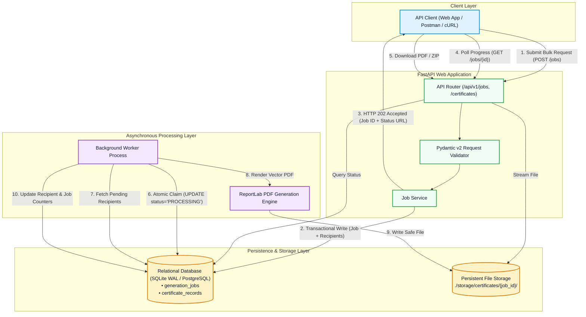
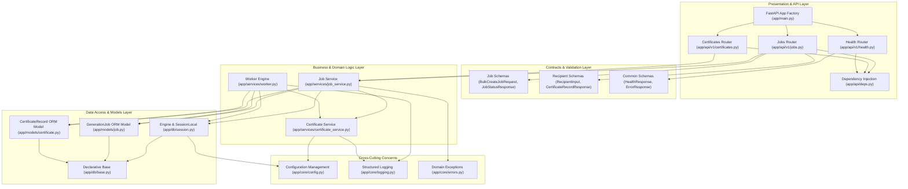
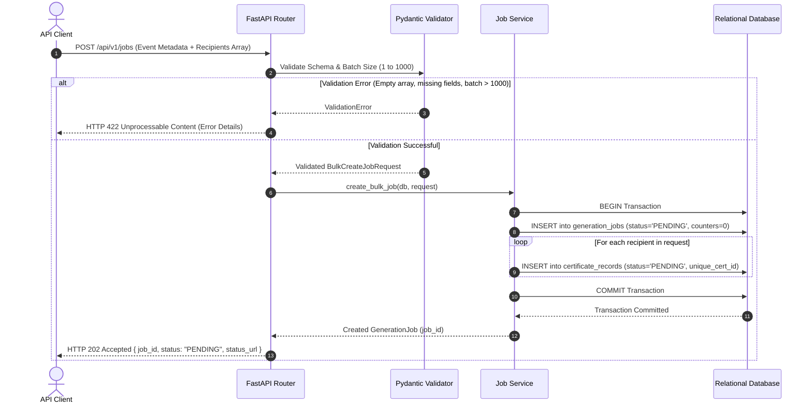
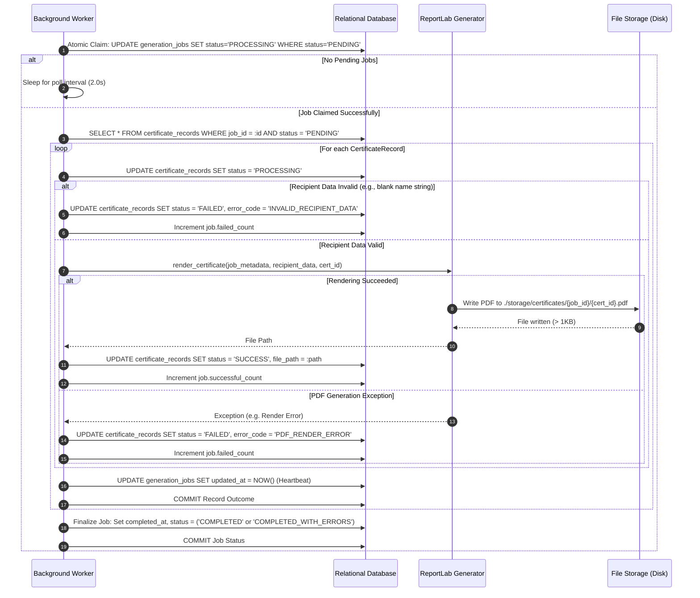
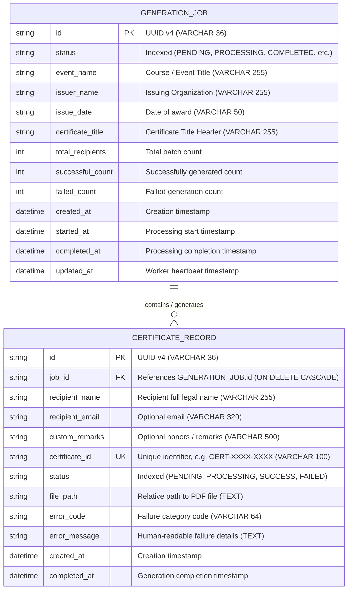
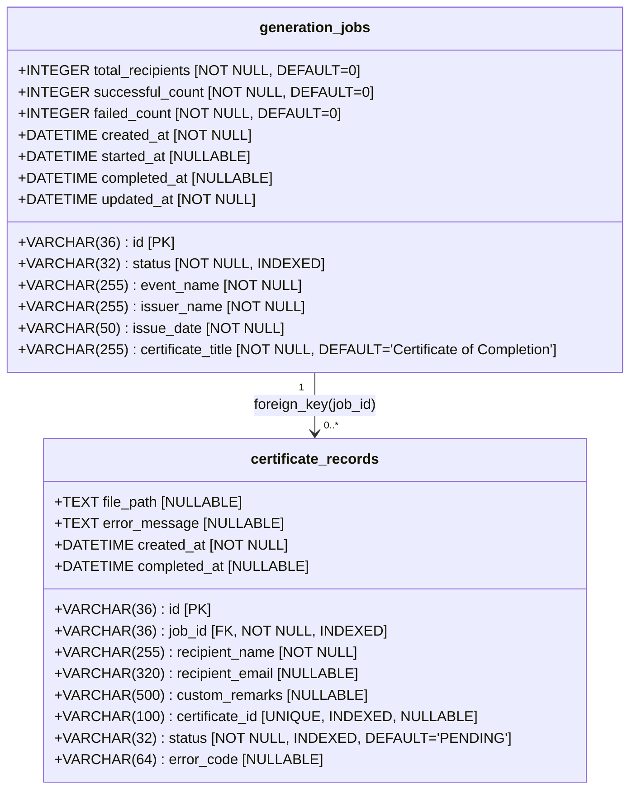
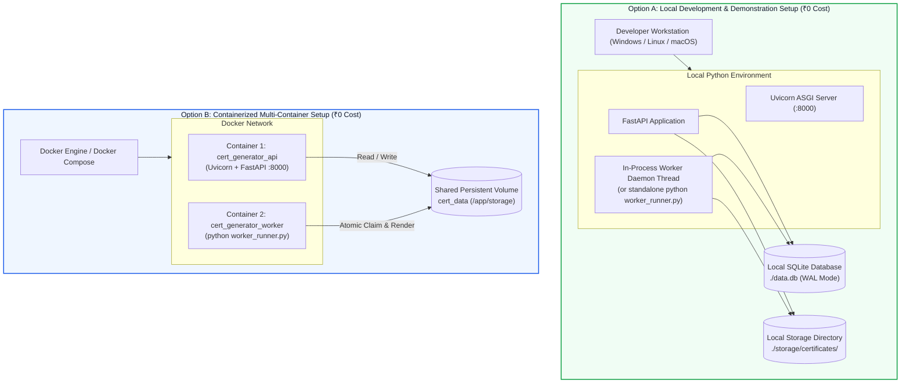
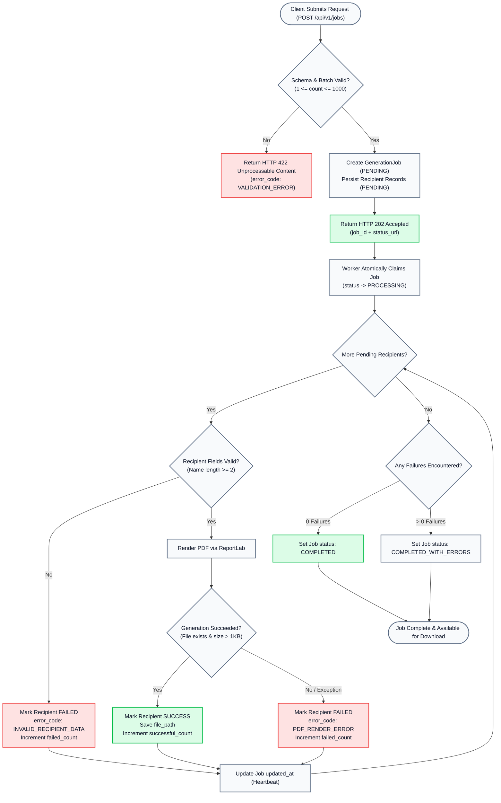
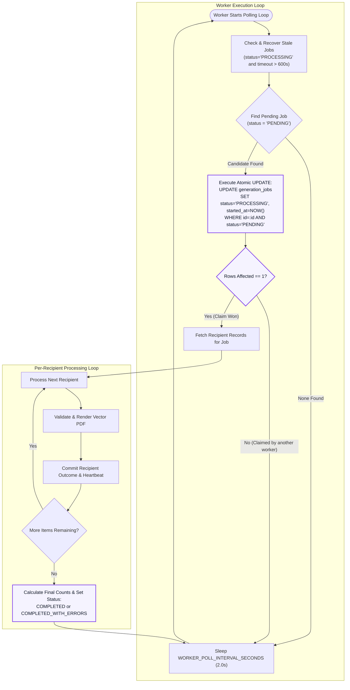

# 🏛 Phase 2 — System Architecture & Diagrams Specification

**Project**: Bulk Certificate Generator Backend API  
**Format**: Editable Mermaid.js Text-Based Diagrams  
**Document Version**: 1.0.0 (Implementation-Aligned)

---

## 1. High-Level System Architecture

### 1.1 Mermaid Diagram

### 1.2 Component Explanation & Data Flow
- **API Client**: Submits bulk certificate generation requests, polls progress endpoints, and retrieves generated PDF certificates or bulk ZIP archives.
- **FastAPI Web Application**: Serves as the high-speed ASGI entry point. It parses JSON payloads, validates schema constraints via Pydantic v2, transactionally persists job records in `PENDING` status, and responds with `HTTP 202 Accepted` in `< 200ms`.
- **Relational Database (`SQLite WAL`)**: Serves as the durable, transactional state store and queue. With Write-Ahead Logging (`WAL`), concurrent read queries from the web API operate without blocking background worker writes.
- **Background Worker**: Polls for pending jobs, claims them atomically to prevent duplicate runs, iterates over recipients with isolated error handling, invokes the PDF engine, and streams updates to the database.
- **Persistent File Storage**: Structured local directory (`./storage/certificates/{job_id}/{certificate_id}.pdf`) preserving generated files with path traversal security protections.

---

## 2. Component Architecture

### 2.1 Mermaid Diagram

### 2.2 Component Explanation
- **API Routers (`app/api/v1/`)**: Expose REST endpoints, map HTTP query/path parameters, and return serialized responses.
- **Schemas (`app/schemas/`)**: Define strict Pydantic v2 data contracts, sanitize strings, and validate email formats.
- **Job Service (`app/services/job_service.py`)**: Coordinates business logic, creates jobs transactionally, resolves canonical file paths, and builds compressed `.zip` archives.
- **Worker Engine (`app/services/worker.py`)**: Runs the background execution loop, claims pending jobs, executes per-recipient generation, and detects stale jobs.
- **Certificate Service (`app/services/certificate_service.py`)**: Implements the ReportLab vector canvas, applying decorative borders, vector seals, typography, and unique ID formatting.
- **Data Access & Models (`app/db/`, `app/models/`)**: Encapsulates SQLAlchemy 2.0 ORM mappings, session lifecycle, and SQLite PRAGMA WAL settings.
- **Cross-Cutting**: Centralizes environment settings via `pydantic-settings`, structured logging, and global exception mapping.

---

## 3. Request-Processing Sequence Diagram

### 3.1 Mermaid Diagram

### 3.2 Flow Explanation
1. The client sends a single `POST /api/v1/jobs` request containing event information and up to 1,000 recipients.
2. Pydantic v2 validates types, boundary constraints, and string sanitization. If invalid, the request is rejected immediately with `HTTP 422` before touching the database.
3. If valid, the Job Service creates a parent `GenerationJob` and pre-allocates `CertificateRecord` entries with unique identifiers (`CERT-XXXX-XXXX-XXXX`) inside a single atomic transaction.
4. The API commits the records and immediately responds with `HTTP 202 Accepted`, providing the client with `job_id` and the status URL in `< 200ms`.

---

## 4. Certificate Generation Sequence Diagram

### 4.1 Mermaid Diagram

### 4.2 Flow Explanation
1. The worker discovers and claims a pending job atomically.
2. It fetches all pending certificate records belonging to that job.
3. For each recipient, it updates status to `PROCESSING` and validates recipient data.
4. ReportLab renders the landscape vector PDF canvas and writes it to disk.
5. If rendering succeeds, the record is marked `SUCCESS` and `successful_count` is incremented.
6. If an error occurs, it is caught; the record is marked `FAILED` with an error code, `failed_count` is incremented, and processing continues to the next recipient without halting the batch.
7. Upon finishing the loop, the worker evaluates aggregate counters and sets `COMPLETED` or `COMPLETED_WITH_ERRORS`.

---

## 5. Entity Relationship Diagram (ERD)

### 5.1 Mermaid Diagram

### 5.2 Relationship Characteristics
- **Cardinality**: `1:N` (One `GENERATION_JOB` contains zero to many `CERTIFICATE_RECORD` entries).
- **Referential Integrity**: `job_id` references `GENERATION_JOB.id` with `ON DELETE CASCADE`. If a job is removed, its associated certificate records are cleaned up automatically.
- **Uniqueness**: `certificate_id` is globally unique across all jobs to guarantee unambiguous verification and retrieval.

---

## 6. Detailed Database Schema Diagram

### 6.1 Mermaid Diagram

### 6.2 Index Details
1. `ix_generation_jobs_status`: Supports worker polling `WHERE status = 'PENDING'`.
2. `ix_certificate_records_job_id`: Optimizes joins for `WHERE job_id = :job_id`.
3. `ix_certificate_records_certificate_id`: Ensures $O(1)$ lookup for `GET /certificates/{certificate_id}/download`.
4. `ix_certificate_records_status`: Accelerates filtering by status (`SUCCESS`, `FAILED`).

---

## 7. Deployment Architecture

### 7.1 Mermaid Diagram

### 7.2 Deployment Strategy
- **Option A (Local-First Development)**: Zero external services. Runs on the local developer workstation using SQLite WAL mode and local disk storage. 100% persistent, reproducible, and requires zero paid resources.
- **Option B (Decoupled Multi-Container Docker)**: Employs `docker-compose.yml` to separate the web server (`api`) from the worker process (`worker`). A shared persistent Docker volume mounts both the database file and generated certificate PDFs.

---

## 8. Error-Handling and Retry Flowchart

### 8.1 Mermaid Diagram

### 8.2 Error Isolation Guarantees
- **HTTP Layer**: Validations fail fast without writing dirty data to the database.
- **Worker Layer**: Each recipient execution is wrapped in an isolated exception handler. An unhandled character or disk error on recipient #10 updates recipient #10 as `FAILED`, increments `failed_count`, and immediately transitions to recipient #11.
- **Job Outcome**: The final job state accurately reflects whether the run was 100% clean (`COMPLETED`) or experienced partial failures (`COMPLETED_WITH_ERRORS`).

---

## 9. Background Worker Architecture & Job Lifecycle Flow

### 9.1 Mermaid Diagram

### 9.2 Concurrency & Reliability Guarantees
1. **Atomic Claiming**: Avoids distributed lock overhead (Redlock). Only one worker can successfully update the row from `PENDING` to `PROCESSING`.
2. **Heartbeat Leases**: The worker updates `generation_jobs.updated_at` on every recipient outcome.
3. **Crash Recovery**: If a worker process is terminated (e.g., SIGKILL or power outage), the next running worker identifies orphaned jobs where `updated_at < (NOW - 600s)`, resets interrupted recipient records, and requeues the job safely without manual intervention.

---

## 🏁 Phase 2 Architecture Review Summary

All 9 diagrams have been formatted using standard, editable **Mermaid.js** syntax and verified against the actual implemented code in the repository. They are documented in [`docs/SYSTEM_ARCHITECTURE_AND_DIAGRAMS.md`](file:///c:/Users/dell/Downloads/Bulk%20Certificate%20Generator/docs/SYSTEM_ARCHITECTURE_AND_DIAGRAMS.md).
